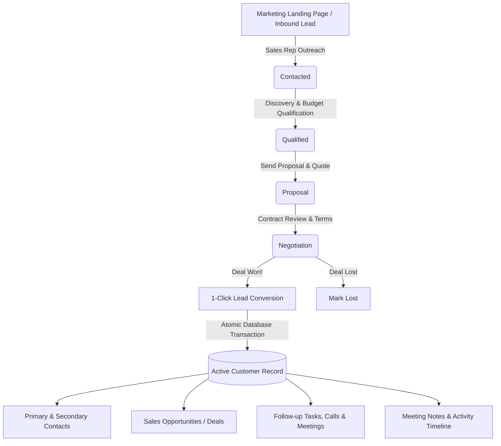

# Enterprise CRM — System Workflow & Operational User Guide

Welcome to the **Enterprise Small-Business CRM Platform**. This documentation explains the complete lifecycle of customer data, business sales workflows, role permissions, and step-by-step instructions on how to access and manage every section of the system.

---

## 📌 Table of Contents
1. [Core Architecture & CRM Lifecycle](#1-core-architecture--crm-lifecycle)
2. [User Roles & Access Levels](#2-user-roles--access-levels)
3. [Quick Start & Accessing the System](#3-quick-start--accessing-the-system)
4. [Public Marketing Landing Page & Onboarding](#4-public-marketing-landing-page--onboarding)
5. [Authentication & 1-Click Demo Login](#5-authentication--1-click-demo-login)
6. [Step-by-Step Operational Workflow Guides](#6-step-by-step-operational-workflow-guides)
   - [A. Executive Dashboard & Analytics](#a-executive-dashboard--analytics)
   - [B. Lead Generation & Visual Kanban Pipeline](#b-lead-generation--visual-kanban-pipeline)
   - [C. 1-Click Lead-to-Customer Atomic Conversion](#c-1-click-lead-to-customer-atomic-conversion)
   - [D. Customer 360° & Contact Management](#d-customer-360-and-contact-management)
   - [E. Opportunity & Deal Tracking](#e-opportunity--deal-tracking)
   - [F. Tasks, Activities & Overdue Follow-ups](#f-tasks-activities--overdue-follow-ups)
   - [G. User Profiles & Workspace Settings](#g-user-profiles--workspace-settings)
7. [Enterprise Django Admin Portal (`/admin/`)](#7-enterprise-django-admin-portal-admin)
8. [Global Navigation, Shortcuts & Omni-Search](#8-global-navigation-shortcuts--omni-search)
9. [Django REST Framework API Access](#9-django-rest-framework-api-access)
10. [Developer & Deployment Reference](#10-developer--deployment-reference)

---

## 1. Core Architecture & CRM Lifecycle

The application automates the end-to-end sales journey from first marketing touchpoint to closing revenue and retaining long-term client accounts.



### Data Relationship Highlights
- **Leads**: Top-of-funnel prospects. They can be tracked through 7 distinct pipeline stages on a visual Kanban board or list table.
- **Conversion**: When a lead reaches `WON`, a 1-click atomic transaction converts the lead into an active **Customer** record and creates their **Primary Contact**.
- **Customer 360°**: Customer records hold linked contacts, communication notes, monetary opportunities, and scheduled activities.
- **Opportunities (Deals)**: Revenue-generating projects tied to customer accounts with deal values ($), win probabilities (%), and target closing dates.
- **Tasks**: Time-sensitive action items (Calls, Meetings, Follow-ups, Tasks) with automatic overdue detection based on server time.

---

## 2. User Roles & Access Levels

The CRM implements Role-Based Access Control (RBAC) via a custom user model:

| Role | Default Access Scope | Capabilities |
| :--- | :--- | :--- |
| 🛡️ **Admin** | System-wide | Full operational rights across all accounts, leads, deals, tasks, plus direct governance over the **Django Admin Portal** (`/admin/`). |
| 💼 **Manager** | Team & Pipeline Oversight | Full visibility into all customer accounts, team pipeline values, stage transitions, and managerial analytics. |
| 👤 **Sales Rep** | Assigned Accounts & Daily Sales | Day-to-day operations: managing assigned prospects, moving leads through stages, updating customer records, creating deals, and logging follow-up tasks. |

### Demo Credentials
| Role | Username | Password |
| :--- | :--- | :--- |
| **Admin** | `admin` | `admin123` |
| **Manager** | `manager1` | `manager123` |
| **Sales Rep** | `sales1` | `sales123` |

---

## 3. Quick Start & Accessing the System

### 1. Launch the Server
Ensure the virtual environment is activated and the Django server is running:
```powershell
.\venv\Scripts\activate
python manage.py runserver
```

### 2. Access the Application
Open your web browser and navigate to:
```
http://127.0.0.1:8000/
```
- **Unauthenticated Visitors**: Will see the high-converting **Public Marketing Landing Page**.
- **Authenticated Users**: Are automatically redirected to the **Executive Dashboard** (`/dashboard/`).

---

## 4. Public Marketing Landing Page & Onboarding

- **URL**: `http://127.0.0.1:8000/`
- **Purpose**: Welcomes visitors, explains the CRM platform's business value, and allows prospective clients or new team members to learn about the system before signing in.

### Key Sections:
1. **Interactive Navigation Bar**:
   - Company branding (`Enterprise CRM`).
   - Feature jump-links: *Features*, *ROI Calculator*, *Testimonials*, *Security*.
   - Direct buttons for **Sign In** and **Start Free Trial**.
   - Dual theme toggle (**Light Mode / Dark Mode**).
2. **Hero Showcase**:
   - Compelling headline and sub-headline highlighting sales acceleration.
   - Call-to-action buttons (*"Get Started Free"*, *"Explore Live Demo"*).
   - Live stat chips highlighting metrics (e.g., *99.9% Uptime*, *4.9/5 Rating*).
3. **Core Feature Pillars**:
   - Visual cards explaining Lead Kanban tracking, Customer 360° timelines, Revenue Forecasting, and Overdue Activity tracking.
4. **Interactive ROI Calculator**:
   - Dynamic client-side sliders allowing visitors to adjust **Sales Team Size** and **Average Deal Size**.
   - Real-time instant calculation of **Projected Annual Revenue Lift ($)** and **Hours Saved Weekly**.
5. **Enterprise Security & Social Proof**:
   - Testimonials from sales leaders and badges for SOC2 compliance, 256-bit encryption, and RBAC governance.

---

## 5. Authentication & 1-Click Demo Login

- **Login URL**: `http://127.0.0.1:8000/accounts/login/`
- **Register URL**: `http://127.0.0.1:8000/accounts/register/`

### 1-Click Quick Demo Login:
To make demonstration and onboarding immediate, the sign-in page includes clickable **Demo Credential Pills** directly on the card:
- Clicking **`Admin`** autofills `admin` / `admin123`.
- Clicking **`Manager`** autofills `manager1` / `manager123`.
- Clicking **`Sales Rep`** autofills `sales1` / `sales123`.

### Additional Sign-In Features:
- **Password Visibility Toggle**: Click the eye icon (`👁️`) to toggle password visibility.
- **Remember Me**: Persistent session cookie support.
- **Return to Landing Page**: Direct link back to the public homepage at any time.

---

## 6. Step-by-Step Operational Workflow Guides

### A. Executive Dashboard & Analytics
- **URL**: `http://127.0.0.1:8000/dashboard/`
- **Purpose**: High-level executive overview of sales velocity and urgent tasks.

#### 1. KPI Metric Cards
- **Total Accounts**: Total customer accounts currently in the CRM with percentage growth indicators.
- **Active Prospects**: Number of active leads currently undergoing qualification.
- **Won Revenue**: Real-time sum of closed-won opportunities + total pipeline valuation.
- **Pending Tasks**: Active action items, with an immediate visual alert badge if any task is **Overdue**.

#### 2. Interactive Chart.js Visuals
- **Lead Pipeline Distribution**: Interactive doughnut chart displaying the proportion of prospects in each stage (`New`, `Contacted`, `Qualified`, `Proposal`, `Negotiation`, `Won`, `Lost`).
- **Opportunity Deal Valuation**: Bar chart aggregating monetary values ($) across deal stages.
- *Both charts dynamically adapt to Light and Dark mode color palettes in real-time.*

#### 3. Live Activity Feeds
- **Recent Accounts**: Quick list of recently onboarded client companies with direct profile links.
- **Urgent Action Items**: Tasks due today or overdue with quick completion toggles.

---

### B. Lead Generation & Visual Kanban Pipeline
- **List View**: `http://127.0.0.1:8000/leads/`
- **Kanban Board**: `http://127.0.0.1:8000/leads/pipeline/`

#### 1. Adding a New Lead
1. Click the **`+ New`** button in the top navbar and choose **`New Lead`**.
2. Complete the lead details:
   - **Title**: Short summary of the prospect opportunity (e.g. `Cloud Migration Project`).
   - **Contact Name & Company**: First name, last name, and organization.
   - **Email & Phone**: Primary communication channels.
   - **Lead Source**: Website, Referral, Cold Call, LinkedIn, Event, or Other.
   - **Stage**: New, Contacted, Qualified, Proposal, Negotiation, Won, or Lost.
   - **Priority**: Low, Medium, or High.
   - **Estimated Value ($)**: Projected contract size.
   - **Assigned Representative**: Sales rep responsible for the prospect.
   - **Follow-up Date**: Target next touchpoint.
3. Click **Save Lead**.

#### 2. Visual Kanban Board
Navigate to **Leads & Pipeline** → **Kanban Pipeline** (`/leads/pipeline/`):
- Columns group leads across the 7 pipeline stages.
- Each card displays lead title, company, priority tag, monetary value, and quick-action buttons.
- Click the pencil icon to update a lead's stage or click the arrow icon to trigger 1-click conversion.

---

### C. 1-Click Lead-to-Customer Atomic Conversion
When a prospect agrees to terms and is marked **WON**:
1. From the Lead Detail page or Kanban card, click **`Convert to Customer`**.
2. You will be prompted with a confirmation screen summarizing the customer record to be generated.
3. Click **`Confirm Conversion`**.
4. The system executes a database transaction (`transaction.atomic()`):
   - Creates a new active **Customer** profile (or links to an existing customer if the email matches).
   - Generates a **Primary Contact** under that customer with the lead's contact details.
   - Sets the lead's status to `WON`.
   - Redirects you straight to the newly created Customer 360° profile.

---

### D. Customer 360° and Contact Management
- **Customer List**: `http://127.0.0.1:8000/customers/`
- **Customer Detail**: `http://127.0.0.1:8000/customers/<id>/`

#### 1. Finding & Filtering Customers
- Use the **Search bar** on the customer list page to filter by name, company, email, or phone.
- Use the **Status dropdown** to filter by `Active Customer`, `Lead`, or `Inactive`.

#### 2. Customer 360° Profile
Opening any customer record displays:
- **Customer Overview**: Company name, status badge, email, phone, office address, and assigned sales rep.
- **Linked Contacts**: List of all stakeholders at the company. Click **`Add Contact`** to add additional contacts with custom designations (e.g. CTO, Finance Director).
- **Communication & Meeting Notes**: Timeline of notes logged by sales reps. Type meeting minutes into the note box and submit to append to the client history.
- **Deals & Opportunities**: All active or historical sales opportunities tied to this client.
- **Scheduled Tasks**: Calls, meetings, or reminders specifically linked to this customer account.

---

### E. Opportunity & Deal Tracking
- **URL**: `http://127.0.0.1:8000/opportunities/`

#### 1. Creating a Deal
1. Click **`+ New`** in the top navbar → **`New Deal`** (or navigate to Opportunities → Add Opportunity).
2. Specify:
   - **Deal Name**: e.g., `Enterprise SaaS Subscription — 100 Seats`.
   - **Customer**: Select the parent customer organization.
   - **Amount ($)**: Total deal valuation.
   - **Stage**: Qualification, Needs Analysis, Proposal / Price Quote, Negotiation, Closed Won, or Closed Lost.
   - **Win Probability (%)**: Estimated percentage chance of closing (0–100%).
   - **Target Closing Date**: Expected contract signature date.
   - **Assigned Representative**: Owner of the deal.
3. Click **Save Opportunity**.

#### 2. Financial Metrics
The Opportunity page automatically calculates:
- **Total Pipeline Valuation**: Aggregate monetary sum of all open deals.
- **Closed Won Revenue**: Sum of all deals reaching the `Closed Won` stage.

---

### F. Tasks, Activities & Overdue Follow-ups
- **URL**: `http://127.0.0.1:8000/tasks/`

#### 1. Scheduling an Activity
1. Click **`+ New`** in the top navbar → **`New Task`**.
2. Fill in:
   - **Task Title**: Description of the activity (e.g., `Demo Presentation Call`).
   - **Activity Type**: Phone Call, Meeting, Follow-up, or General Task.
   - **Priority**: Low, Medium, or High.
   - **Due Date & Time**: Target deadline for completion.
   - **Related Record**: Optionally link the task to a specific **Customer**, **Lead**, or **Opportunity**.
3. Click **Create Task**.

#### 2. Completing & Toggling Tasks
- Tasks can be toggled between `Pending` and `Completed` directly by clicking the status circle icon on the task table.
- Any task past its `due_date` that is still `Pending` or `In Progress` is automatically flagged as **Overdue** with an alert badge and highlighted in red on both the list and the dashboard.

---

### G. User Profiles & Workspace Settings
- **URL**: `http://127.0.0.1:8000/accounts/profile/`
- View your operational role, assigned customer account counts, active leads, and pending tasks.
- Update your First Name, Last Name, Email Address, Phone Number, and Bio.

---

## 7. Enterprise Django Admin Portal (`/admin/`)

- **URL**: `http://127.0.0.1:8000/admin/`
- **Access**: Requires `is_staff` or `ADMIN` role.

The Django Admin has been overhauled into an enterprise data management console with dedicated styling, quick navigation, and rich operational controls.

### 1. Branding & Header Controls
- **Enterprise Title**: Header displays `Enterprise CRM Administration` with custom typography and badge pill.
- **Direct Navigation Shortcuts**: Quick buttons directly in the top right to open the **CRM Dashboard** (`/dashboard/`) or public **Website** (`/`) in new tabs without having to change URLs manually.

### 2. ModelAdmin Enhancements
- **User Management (`accounts.User`)**:
  - Displays username, full name, email, and color-coded role badges (`Admin` in red, `Manager` in amber, `Sales Representative` in blue).
  - Bulk actions to reassign roles or toggle active/inactive status in one click.
- **Customer Governance (`customers.Customer`)**:
  - Color-coded status badges (`Active Customer`, `Lead`, `Inactive`).
  - Total linked contacts count and aggregated won revenue display ($).
  - Tabular inlines for immediate inspection of linked contacts and activity notes.
- **Lead Pipeline Management (`leads.Lead`)**:
  - 7-stage status pills and priority badges (`High`, `Medium`, `Low`).
  - Formatted currency values ($) and date hierarchy filters.
  - Bulk actions: *Advance to Qualified*, *Advance to Proposal*, *Mark as Won*, *Mark as Lost*.
- **Opportunity Management (`opportunities.Opportunity`)**:
  - Formatted deal valuation and visual win probability progress bars (`0–100%`).
  - Dynamic weighted value calculation (`Deal Value × Probability`).
  - Overdue warning alerts on expected closing dates that have lapsed.
- **Task Management (`tasks.Task`)**:
  - Task type icon pills (`📞 Call`, `👥 Meeting`, `🔄 Follow-up`, `✅ Task`).
  - Dynamic `🚨 OVERDUE` indicator for incomplete tasks past their deadline.
  - Bulk actions: *Mark Completed*, *Mark In Progress*, *Mark Pending*.

---

## 8. Global Navigation, Shortcuts & Omni-Search

The top navigation header is available across the entire platform and provides:

| Feature | Shortcut / Usage | Description |
| :--- | :--- | :--- |
| **Global Omni-Search** | **`Ctrl+K`** (or `⌘K` on Mac) | Instantly focuses the search input to locate accounts, leads, deals, or contacts across the entire CRM. |
| **`+ New` Quick Create** | Click **`+ New`** button | Dropdown menu allowing instant creation of a Lead, Customer, Opportunity, or Task from anywhere. |
| **Theme Switcher** | Sun / Moon Icon | One-click toggle between **Light Mode** and **Dark Mode**. Persists across browser refreshes via `localStorage`. |
| **User Profile Menu** | Avatar Dropdown | Access your Profile, My Tasks, or Sign Out with role display. |
| **Mobile Drawer** | Hamburger (`☰`) | Smooth sliding off-canvas navigation menu for mobile and tablet screens. |

---

## 9. Django REST Framework API Access

The application includes a REST API powered by Django REST Framework (DRF):

### Authentication
API endpoints support both **Session Authentication** (browser cookies) and **Basic Authentication** (`Authorization: Basic <base64>`).

### Key Endpoints
| Resource | URL Endpoint | Supported Methods | Description |
| :--- | :--- | :--- | :--- |
| **Users** | `/api/users/` | `GET` | List CRM users and assigned roles |
| **Customers** | `/api/customers/` | `GET`, `POST`, `PUT`, `PATCH`, `DELETE` | Full CRUD operations for client accounts |
| **Leads** | `/api/leads/` | `GET`, `POST`, `PUT`, `PATCH`, `DELETE` | Full CRUD operations for sales leads |
| **Opportunities** | `/api/opportunities/` | `GET`, `POST`, `PUT`, `PATCH`, `DELETE` | CRUD operations for deals & financials |
| **Tasks** | `/api/tasks/` | `GET`, `POST`, `PUT`, `PATCH`, `DELETE` | CRUD operations for follow-up activities |

### Interactive Browsable API
Log into the web application, then navigate directly to:
```
http://127.0.0.1:8000/api/
```
You can inspect schemas, send `POST` payloads, and test filters directly in your browser.

---

## 10. Developer & Deployment Reference

### Running System Tests
Run the automated test suite covering models, roles, conversions, and API responses:
```powershell
.\venv\Scripts\activate
python manage.py test
```

### Running Django Deployment Security Checks
```powershell
python manage.py check --deploy
```

### Applying Database Migrations
```powershell
python manage.py makemigrations
python manage.py migrate
```

---

*Enterprise CRM Documentation — Built with Django 5+, Bootstrap 5.3, Chart.js, and Django REST Framework.*
